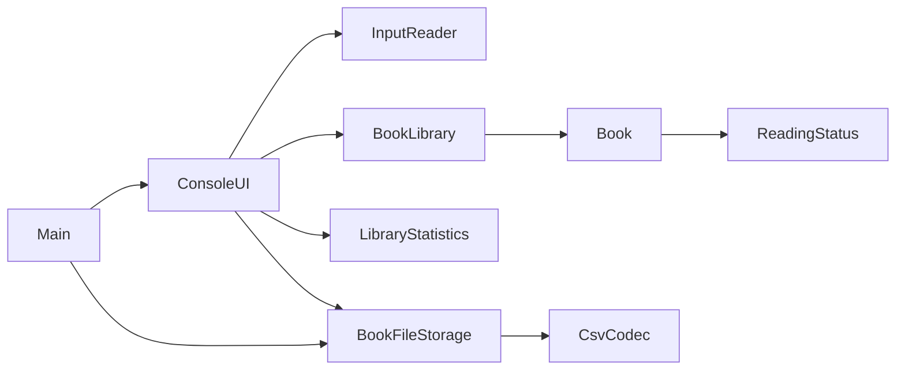

# Book Tracker

A Java console application for managing a personal reading library.
Add books, track progress, rate finished books and keep your library between sessions.
Developed with a coding assistant as a learning project.

## Features

- Add, view, edit and delete books with stable numeric IDs.
- Search titles, authors and categories, ignoring letter case.
- Track pages read; reading status is calculated automatically.
- Rate finished books from 1 to 5, or remove a rating.
- Filter by status and sort by title, author, year, rating or progress.
- View reading totals and the average rating of rated books.
- Automatically save changes to UTF-8 CSV and load them on startup.
- Preserve the previous saved version in a .bak file.
- Validate input, confirm deletions and report failed saves.

## Quick start

Requires **JDK 17 or newer**. No external Java libraries are needed.

Clone the repository:

```bash
git clone https://github.com/mohammedaslwiy/book-tracker.git
cd book-tracker
```

Open this whole folder in IntelliJ IDEA, select a project JDK, and run
src/Main.java. Use this project folder as the run configuration's working directory.

From a terminal in this folder on Windows:

```powershell
.\run.cmd
```

Or compile and run manually:

```powershell
New-Item -ItemType Directory -Force build | Out-Null
javac -encoding UTF-8 --release 17 -d build src/*.java
java '-Dfile.encoding=UTF-8' -cp build Main
```

On macOS/Linux:

```bash
mkdir -p build
javac -encoding UTF-8 --release 17 -d build src/*.java
java -Dfile.encoding=UTF-8 -cp build Main
```

## Example session

Choose 1 to add a book:

```text
Title: Java Basics
Author: Mohammed
Publication year: 2026
Category: Programming
Total pages: 200
Added book #1.
Library saved.
```

Choose 6, enter ID 1, and enter 60 pages read: the status becomes Reading.
Entering 200 makes it Finished, so you can rate it using option 7.
Choose 0 to exit. Restart to see the saved book.

## Design

```text
book-tracker/
  src/                     Application classes
  tests/BookTrackerTests.java
  examples/FirstBookDemo.java
  run.cmd                  Windows launcher
  run.ps1                  PowerShell launcher
  test.ps1                 Test runner
  README.md                English project documentation
  GUIDE-AR.md               Arabic learning guide
  PROVENANCE.md             Learning and authorship details
```

| Class | Responsibility |
| --- | --- |
| Main | Select the data file, load the library and start the application. |
| Book | Store one book and validate metadata, progress and ratings. |
| ReadingStatus | Represent not started, reading and finished states. |
| BookLibrary | Manage IDs, books, searching, filtering and sorting. |
| ConsoleUI | Present the menu and coordinate user actions. |
| InputReader | Read and validate console input. |
| BookFileStorage | Load and save books with a previous-save backup. |
| CsvCodec | Encode and parse quoted CSV records. |
| LibraryStatistics | Calculate reading and rating summaries. |



## Rules and storage

- Titles, authors and categories contain 1-200 characters.
- Publication years range from 1 through next year; total pages range from 1 to 1,000,000.
- Pages read range from 0 through the total page count.
- Only finished books may have a rating. Reducing progress, or increasing the total
  page count beyond pages already read, clears the rating.
- IDs stay stable; deleted IDs are not reused after restarting.
- Default data: data/books.csv. The previous save is data/books.csv.bak.
- The first CSV record stores the format version and next ID; the second contains
  column names. This is the application's own format, not a generic CSV import feature.
- Quotes, commas, Unicode and multiline CSV fields round-trip correctly.
- Startup rejects malformed data without overwriting it. Save failures leave changes
  in memory and are reported; exiting with unsaved changes requires confirmation.
- Run one application instance per data file. This is a personal console application.
- Data, compiled files and IDE settings are excluded from Git.

Use a separate data file for a demo:

```powershell
.\run.cmd data/demo.csv
```

## Tests

```powershell
.\test.ps1
```

If PowerShell scripts are restricted, run the commands directly:

```powershell
javac -encoding UTF-8 --release 17 -d build src/*.java tests/*.java
java '-Dfile.encoding=UTF-8' -cp build BookTrackerTests
```

The dependency-free suite runs **64 behavioral checks**, covering business rules,
UTF-8 CSV persistence, stable IDs, malformed files, input recovery, deletion,
EOF handling and failed saves.

## Learning history

This repository is part of [mohammedaslwiy's](https://github.com/mohammedaslwiy)
Java learning portfolio. It demonstrates classes and objects, encapsulation,
collections, input validation, exception handling, file persistence and Git.
The expanded implementation was developed with a coding assistant; the earlier
personal practice and future changes are tracked in the repository history.

examples/FirstBookDemo.java preserves the earlier one-book exercise, including
the student's title/author changes and keyboard-input step. Its class was renamed
to coexist with the application's Main class.

See [GUIDE-AR.md](GUIDE-AR.md) for the Arabic walkthrough and
[PROVENANCE.md](PROVENANCE.md) for authorship details.
